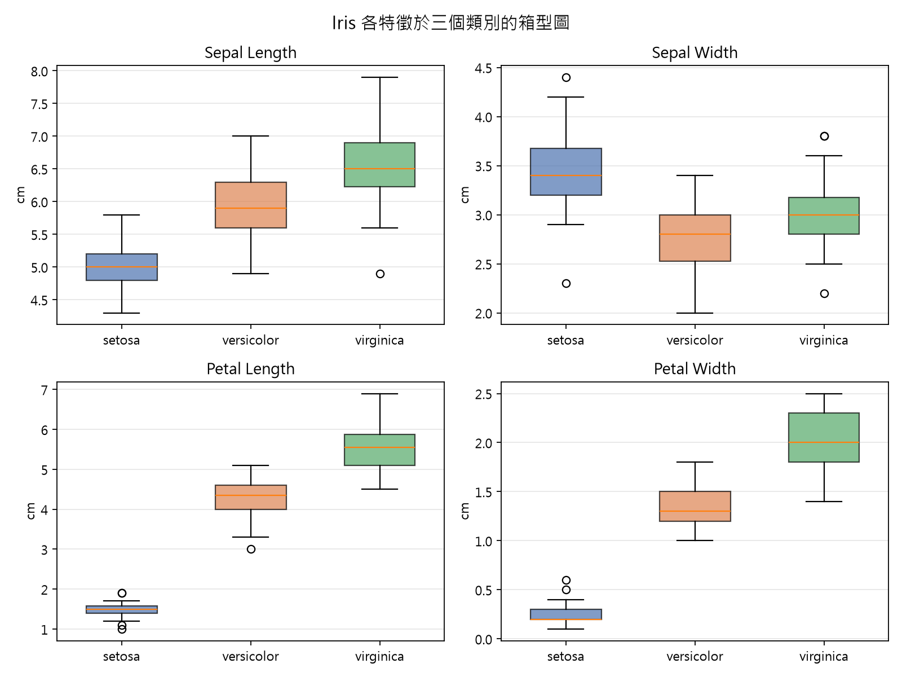
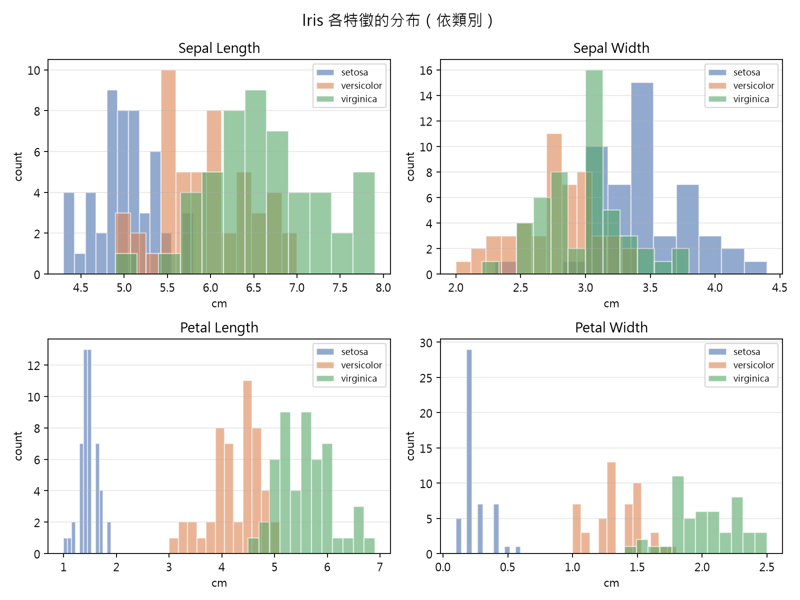
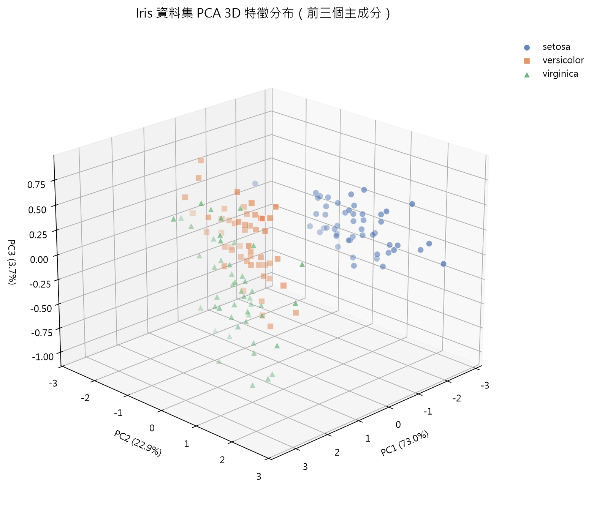
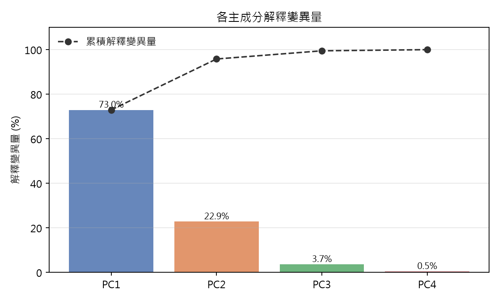
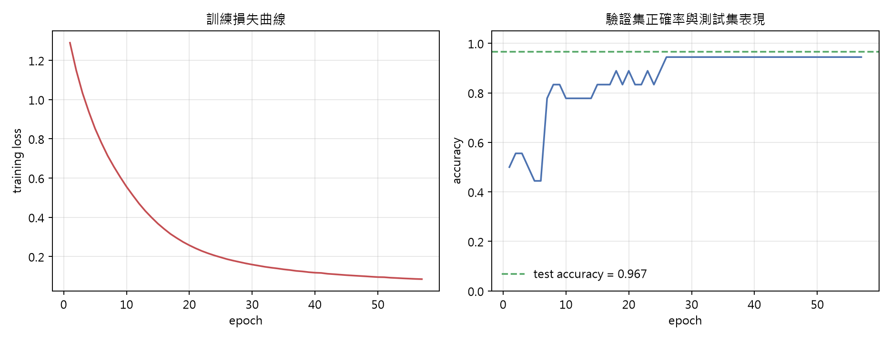
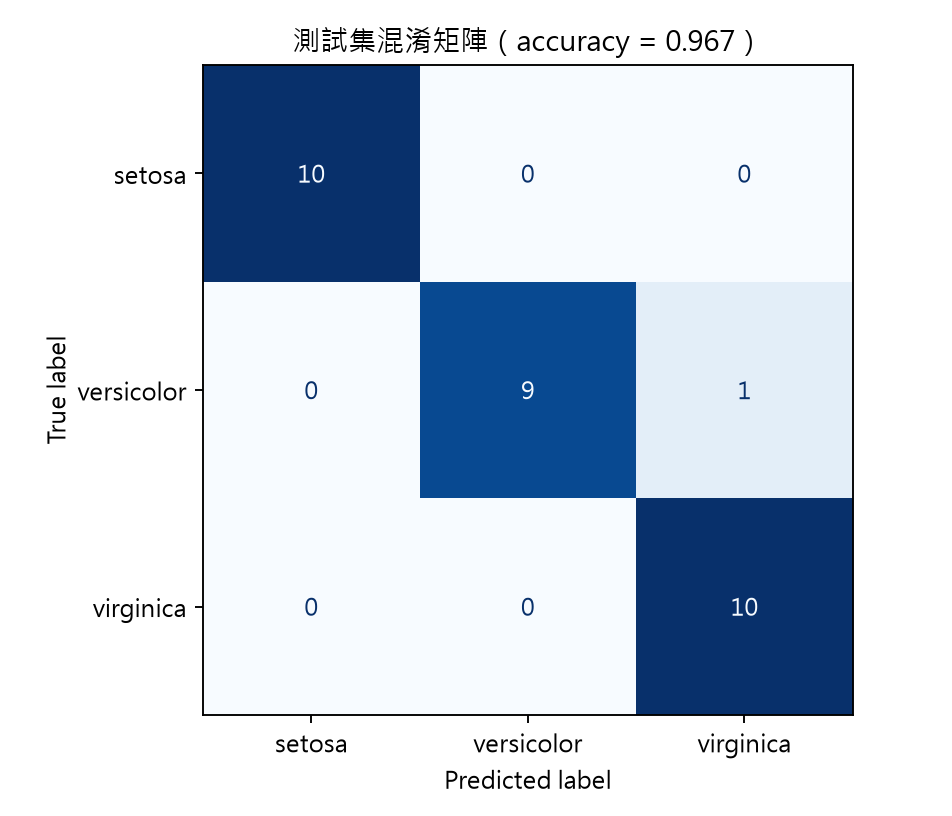
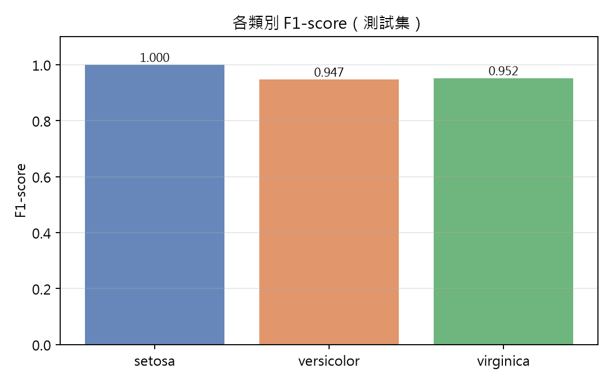

# 以主成分分析視覺化與多層感知器分類 Iris 資料集

**A Study on Iris Dataset Classification: PCA-Based Visualization and Multi-Layer Perceptron**

---

## 摘要

本研究以 Fisher（1936）提出的 Iris 資料集為對象，完成一個完整的監督式分類流程。首先將資料保存為專案內的 CSV 檔案，並進行缺失值、重複值、離群值與類別平衡等基本檢查；接著以主成分分析（PCA）將四個量測特徵投影到三維空間，視覺化三個物種的分群結構；最後建立一個多層感知器（Multi-Layer Perceptron, MLP）類神經網路模型，以 80/20 分層抽樣切分訓練與測試資料，並以五折交叉驗證確認模型穩定性。

實驗結果顯示，前三的主成分共可解釋 **99.48%** 的總變異量，且三維散佈圖中 *setosa* 與另外兩類明顯分離，*versicolor* 與 *virginica* 則存在部分重疊。MLP 模型在訓練集五折交叉驗證的正確率為 **95.83% ± 4.56%**，在 30 筆測試資料上達到 **96.67%** 的正確率，唯一誤判為一筆 *versicolor* 被預測成 *virginica*。結果顯示，即使僅使用極少量的資料與一個淺層網路，Iris 這類低維度、類別分離度高的資料仍可被有效分類；誤判主要來自兩個生物學上本來就相近的類別之邊界樣本。

**關鍵詞**：Iris 資料集、主成分分析、類神經網路、多層感知器、混淆矩陣

---

## 1. 緒論

### 1.1 研究動機

Iris 資料集是機器學習領域最經典的入門資料集之一，常用於驗證分類演算法與視覺化方法。它同時具備「特徵維度低」、「類別平衡」、「部份類別線性不可分」等特性，因此非常適合作為理解完整分析流程的教材：從資料檢查、降維視覺化，到模型訓練與評估，都能在單一資料集上具體呈現。

### 1.2 研究問題

本研究欲回答三個問題：

1. Iris 的四個特徵中，是否存在能以少數維度保留大部分資訊的結構？
2. 以 PCA 投影到三維後，三個物種是否呈現可辨識的分群？
3. 一個簡單的類神經網路，在此資料集上能達到什麼樣的分類表現？錯誤主要發生在哪裡？

### 1.3 研究流程

資料取得與保存 → 資料理解與探索 → PCA 三維視覺化 → MLP 模型訓練與評估 → 結果討論與小論文撰寫。

---

## 2. 資料集描述

### 2.1 資料來源

Iris 資料集由英國統計學家 Ronald A. Fisher 於 1936 年發表，原始量測由 Edgar Anderson 在美國紐約與加拿大加斯佩半島採集。本研究透過 scikit-learn 的 `load_iris` 取得資料（內容與 UCI Machine Learning Repository 上的 Iris 版本一致），並匯出為 `data/iris.csv`，使後續分析不依賴套件內建資料，確保可重現性。

### 2.2 欄位與特徵

| 欄位 | 型別 | 說明 | 單位 |
| --- | --- | --- | --- |
| `sepal_length` | 數值 | 花萼長度 | cm |
| `sepal_width` | 數值 | 花萼寬度 | cm |
| `petal_length` | 數值 | 花瓣長度 | cm |
| `petal_width` | 數值 | 花瓣寬度 | cm |
| `species` | 類別 | 物種標籤（分類目標） | — |

- **特徵（features）**：4 個連續數值欄位，即花萼與花瓣的長寬。
- **分類（target / classes）**：`species` 共有三類——`setosa`、`versicolor`、`virginica`，每類 50 筆，共 150 筆，屬完全平衡資料集。

### 2.3 基本檢查結果

完整內容見 [`docs/eda_report.md`](eda_report.md)，重點摘要如下：

| 檢查項目 | 結果 |
| --- | --- |
| 資料筆數 × 欄位數 | 150 × 5 |
| 缺失值 | 0 |
| 完全重複列 | 1（保留，因屬不同觀測個體量到相同數值） |
| 類別分布 | 三類各 50 筆（33.3%） |
| 離群值（IQR 準則） | 僅 `sepal_width` 有 4 筆超出 [2.05, 4.05]，其餘特徵為 0 |
| 特徵尺度 | 花瓣長度範圍 1.0–6.9 cm，花萼寬度僅 2.0–4.4 cm，尺度差異明顯 → 需標準化 |

敘述統計：

| 特徵 | 平均 | 標準差 | 最小值 | 中位數 | 最大值 |
| --- | --- | --- | --- | --- | --- |
| sepal_length | 5.843 | 0.828 | 4.30 | 5.80 | 7.90 |
| sepal_width | 3.057 | 0.436 | 2.00 | 3.00 | 4.40 |
| petal_length | 3.758 | 1.765 | 1.00 | 4.35 | 6.90 |
| petal_width | 1.199 | 0.762 | 0.10 | 1.30 | 2.50 |

相關係數方面，`petal_length` 與 `petal_width` 的 Pearson 相關係數高達 **0.963**，`sepal_length` 與 `petal_length` 亦達 **0.872**；相對地 `sepal_width` 與其他特徵呈弱負相關（−0.118 ~ −0.428）。高度相關意味著特徵間存在冗餘，這也是後續以 PCA 降維的主要依據。



*圖 1：各特徵於三個類別的箱型圖。花瓣長度與花瓣寬度在 *setosa* 與其他兩類之間幾乎沒有重疊。*



*圖 2：各特徵依類別的直方圖。*

---

## 3. 研究方法

### 3.1 前處理

1. **特徵標準化**：以 `StandardScaler` 將每個特徵轉為平均值 0、標準差 1。標準化參數僅以訓練集估計，再套用到測試集，避免資料洩漏。PCA 與 MLP 皆使用標準化後的特徵。
2. **資料切分**：採分層抽樣（stratified sampling），訓練集 120 筆、測試集 30 筆（80/20），`random_state = 42` 以確保可重現。
3. **類別標籤**：scikit-learn 內部以整數 0/1/2 編碼，評估時再映射回物種名稱。

### 3.2 主成分分析（PCA）

PCA 為一種線性降維方法，尋找資料變異量最大的正交方向（主成分），將原始 \(d\) 維特徵投影到 \(k\) 維子空間。轉換式為：

\[
Z = XW,\quad W = [w_1, w_2, \dots, w_k]
\]

其中 \(w_i\) 為共變異數矩陣的第 \(i\) 個特徵向量。本研究保留前三個主成分（\(k=3\)）以便以 3D 散佈圖呈現，並檢視各主成分的解釋變異量比例：

\[
\text{EVR}_i = \frac{\lambda_i}{\sum_{j=1}^{d}\lambda_j}
\]

### 3.3 多層感知器（MLP）

MLP 為前饋式類神經網路，每個神經元計算 \(a = f(\mathbf{w}^\top \mathbf{x} + b)\)，其中 \(f\) 為非線性活化函數。本研究採用兩層隱藏層架構：

- 輸入層：4 個節點（對應 4 個特徵）
- 隱藏層：32 → 16 個節點，活化函數 ReLU
- 輸出層：3 個節點，對應三個類別（softmax 交叉熵損失）
- 優化器：Adam，初始學習率 0.001，L2 正則化係數 \(\alpha = 10^{-4}\)
- 批次大小 16，最大 600 epochs，並啟用 early stopping（驗證比例 15%、連續 30 個 epoch 未改善即停止）

採用 early stopping 除了避免過擬合，也讓訓練過程的驗證正確率可被記錄下來，用於繪製訓練曲線。

---

## 4. 實驗設計

| 項目 | 設定 |
| --- | --- |
| 訓練 / 測試 | 120 / 30（80/20，分層抽樣） |
| 交叉驗證 | Stratified 5-fold（僅在訓練集上） |
| 特徵前處理 | StandardScaler（以訓練集 fit） |
| 模型 | MLPClassifier(32, 16), ReLU, Adam |
| 學習率 / L2 | 1e-3 / 1e-4 |
| Batch size | 16 |
| 最大 epoch | 600（early stopping，實際 57 epochs 停止） |
| 隨機種子 | 42 |
| 評估指標 | Accuracy、Precision、Recall、F1-score、Confusion Matrix |

程式使用 Python 3.12、scikit-learn 1.9.0、pandas 3.0.5、matplotlib 3.11.2。

---

## 5. 結果與討論

### 5.1 PCA 三維特徵分布

| 主成分 | 解釋變異量 | 累積解釋變異量 |
| --- | --- | --- |
| PC1 | 72.96% | 72.96% |
| PC2 | 22.85% | 95.81% |
| PC3 | 3.67% | 99.48% |
| PC4 | 0.52% | 100.00% |

前兩個主成分即解釋了 95.81% 的變異量，前三個合計 99.48%，說明原本 4 維特徵幾乎可被 3 維完整代表。PC1 的荷重向量約為 (0.52, −0.27, 0.58, 0.56)，主要由花瓣長度、花瓣寬度與花萼長度同向組成，可理解為「花朵整體尺寸」；PC2 則以花萼寬度（0.92）為主，代表「花萼寬窄」。



*圖 3：Iris 資料集前三個主成分的 3D 散佈圖（括號內為該主成分的解釋變異量比例）。*

由圖 3 可見：

- **setosa**（藍色圓點）在 PC1 上明顯偏向低值，與其他兩類完全分離，形成獨立的群。
- **versicolor**（橘色方塊）位於中間，**virginica**（綠色三角）偏向 PC1 高值端；兩者在 PC1–PC2 平面上相鄰，邊界處有樣本交錯。
- 即使加上 PC3，versicolor 與 virginica 仍有少量重疊，表示這兩類在量測特徵上本來就較接近，無法以線性投影完全分開。



*圖 4：各主成分解釋變異量與累積解釋變異量。*

### 5.2 模型訓練過程

模型在第 57 個 epoch 因 early stopping 停止。訓練損失在前期快速下降，之後趨於平緩；驗證集正確率在前 20 個 epoch 內即達到 0.9 以上並維持穩定，顯示此網路容量對 Iris 而言相當充足，且沒有明顯過擬合。



*圖 5：左為訓練損失曲線，右為驗證集正確率曲線（虛線為最終測試集正確率）。*

### 5.3 分類表現

| 資料集 | Accuracy |
| --- | --- |
| 訓練集 5-fold CV | 95.83% ± 4.56% |
| 測試集（30 筆） | **96.67%**（29/30） |

各類別指標（測試集）：

| 類別 | Precision | Recall | F1-score | 樣本數 |
| --- | --- | --- | --- | --- |
| setosa | 1.000 | 1.000 | 1.000 | 10 |
| versicolor | 1.000 | 0.900 | 0.947 | 10 |
| virginica | 0.909 | 1.000 | 0.952 | 10 |
| **Macro avg** | 0.970 | 0.967 | **0.967** | 30 |
| **Weighted avg** | 0.970 | 0.967 | 0.967 | 30 |



*圖 6：測試集混淆矩陣。*



*圖 7：各類別 F1-score。*

### 5.4 錯誤分析

30 筆測試資料中僅有 1 筆誤判：一筆真實標籤為 **versicolor** 的樣本被預測為 **virginica**，使 versicolor 的 recall 降至 0.9、virginica 的 precision 降至 0.909。此結果與 5.1 節的視覺化觀察一致——錯誤發生在 versicolor 與 virginica 的重疊區域，而非 setosa。

值得注意的是，這兩類在生物學上親緣關係較近，花瓣尺寸的分布本身存在重疊；即使是文獻上的線性模型（如 Fisher 的線性判別分析）也常在這一對類別上出現 1–3 筆誤差。因此 96.67% 的表現屬於此資料集的合理水準。

五折交叉驗證的標準差 4.56% 相對較大，主因是每折驗證集僅 24 筆，單一錯誤即造成約 4% 的波動；這也提醒我們在小資料集上不宜只看單一分割的結果。

### 5.5 討論與限制

1. **PCA 的角色**：PCA 只作為視覺化與理解結構之用，分類模型仍使用標準化後的四個原始特徵，以避免降維造成的資訊損失（PC3 之後僅剩 0.52% 變異量，影響有限，但仍非必要）。
2. **模型容量**：Iris 僅 150 筆，兩層隱藏層已明顯過剩。實驗中若加大網路或延長訓練，驗證正確率並未提升，反而增加變異。
3. **資料量限制**：測試集只有 30 筆，單一誤判即改變 3.3 個百分點，指標的置信區間較寬。
4. **超參數選擇**：本研究未進行系統性網格搜尋，超參數依常見慣例設定；但因資料簡單，模型對此並不敏感。

---

## 6. 結論與未來改進

### 6.1 結論

1. Iris 的四維特徵具有高度相關性，前三個主成分即可保留 99.48% 的變異量；二維已達 95.81%。
2. PCA 三維散佈圖清楚呈現 setosa 的獨立分群，以及 versicolor 與 virginica 的部分重疊，與後續模型誤判位置相符。
3. 兩層 MLP 在測試集達到 96.67% 正確率、macro F1 0.967，五折交叉驗證 95.83% ± 4.56%，符合本資料集的預期水準。

### 6.2 未來改進

- 以**重複分層 K 折交叉驗證**（repeated stratified k-fold）取代單次切分，取得更穩定的性能估計與信賴區間。
- 對 versicolor / virginica 邊界樣本進行**針對性分析**（如 margin、預測機率），或比較 SVM、Random Forest、KNN 等模型。
- 進行**超參數搜尋**（GridSearchCV / Optuna），並加入 learning curve 觀察資料量對表現的影響。
- 使用 **Keras / PyTorch** 實作並比較不同優化器、正則化與 dropout 的效果，同時輸出更細緻的訓練日誌。

---

## 參考文獻

1. Fisher, R. A. (1936). The use of multiple measurements in taxonomic problems. *Annals of Eugenics*, 7(2), 179–188.
2. Anderson, E. (1935). The irises of the Gaspé Peninsula. *Bulletin of the American Iris Society*, 59, 2–5.
3. Dua, D., & Graff, C. (2019). UCI Machine Learning Repository: Iris Data Set. University of California, Irvine.
4. Jolliffe, I. T. (2002). *Principal Component Analysis* (2nd ed.). Springer.
5. Kingma, D. P., & Ba, J. (2015). Adam: A Method for Stochastic Optimization. *ICLR 2015*.
6. Pedregosa, F. et al. (2011). Scikit-learn: Machine Learning in Python. *JMLR*, 12, 2825–2830.
7. Goodfellow, I., Bengio, Y., & Courville, A. (2016). *Deep Learning*. MIT Press.

---

## 附錄：專案結構

```
26-ai-new-power/
├─ data/iris.csv              # 原始資料（150 筆）
├─ src/
│  ├─ utils.py                # 共用路徑與工具
│  ├─ data_prep.py            # 資料匯出、EDA、圖表
│  ├─ pca_3d.py               # PCA 3D 視覺化
│  ├─ nn_model.py             # MLP 訓練與評估
│  └─ run_all.py              # 一鍵重現全部結果
├─ figures/                   # 所有輸出圖表
├─ results/                   # PCA 與模型評估的 JSON 結果
├─ docs/
│  ├─ eda_report.md           # 自動產生的探索報告
│  └─ iris-nn-paper.md        # 本小論文
└─ README.md
```
